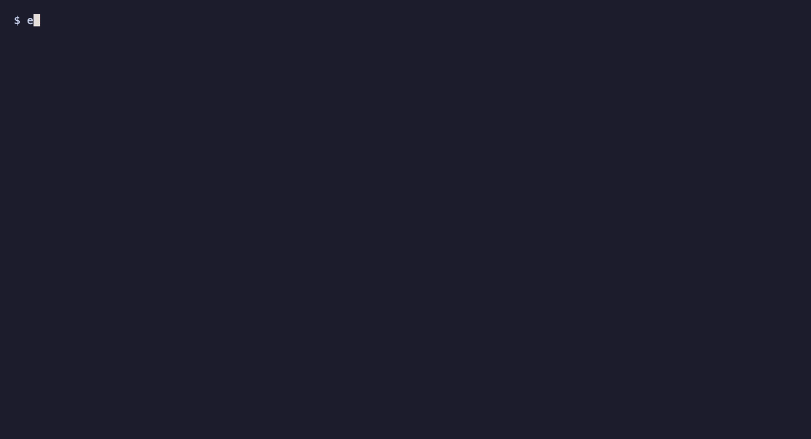

# envy

**Diff, audit, and safely inject `.env` files, without leaving the terminal.**

[](https://github.com/yassataiseer/envy/actions/workflows/ci.yml)
[](LICENSE)



envy is a single static binary that catches the `.env` mistakes that cause
silent crashes and leaked credentials:

- **Drift.** Your `.env` is missing a key someone added to `.env.example`, and
  the app crashes at runtime. `envy diff` shows the difference side by side and
  lets you fix it with a keystroke.
- **Client-side leaks.** `NEXT_PUBLIC_STRIPE_SECRET` gets inlined into your
  browser bundle and is now public. `envy audit` knows which prefixes Next.js,
  Vite, Nuxt, Expo, and friends ship to the client.
- **Secrets on disk.** `envy run` injects variables straight into your
  command's environment. Nothing is written to a temp file.

No accounts, no network access, no daemon. Commands finish in a few
milliseconds, so they fit in pre-commit hooks and CI.

## Install

```sh
# Homebrew (macOS, Linux)
brew install yassataiseer/tap/envy

# Go 1.26+
go install github.com/yassataiseer/envy@latest
```

Prebuilt binaries for macOS, Linux, and Windows are on the
[releases page](https://github.com/yassataiseer/envy/releases).

## Quick start

```sh
envy diff .env .env.example        # interactive side-by-side diff
envy audit                         # scan .env for leaked secrets
envy run -- npm start              # run with .env injected
envy sanitize .env -o .env.example # generate a safe template
```

## Commands

### `envy diff <source> <target>`

In a terminal, opens a two-pane view. Values are masked until you press `m`.

| Key | Action |
| --- | --- |
| `j` / `k`, `g` / `G` | move, jump to top or bottom |
| `tab`, `h` / `l` | switch the focused pane |
| `space` | copy the selected key from the focused pane to the other |
| `>` / `<` | copy left to right / right to left |
| `d` | delete the key from the focused pane |
| `u` | undo |
| `m` | reveal or mask values |
| `f` | show only differences |
| `s` | save (atomic, keeps file permissions and formatting) |
| `q` | quit (asks if there are unsaved changes) |

Rows are marked `~` changed, `≠` type mismatch (`PORT=8080` vs `PORT=abc`),
`-` missing in the target, `+` missing in the source, and `!` for a key that
leaks a secret. Copied keys are inserted next to the same neighbor they have
in the source file, and untouched lines are written back byte for byte.

When output is not a terminal, or with `--no-interactive`, envy prints a
report instead (values are omitted unless you pass `--show-values`):

```text
--- .env
+++ .env.example
~ DATABASE_URL               value differs
≠ DEBUG                      type mismatch (bool vs string)
+ REDIS_URL                  missing in .env
- NEXT_PUBLIC_STRIPE_SECRET  missing in .env.example

4 differences: 1 changed, 1 type mismatch, 1 missing in .env.example, 1 missing in .env
```

Use `--keys-only` to compare key names only (what you usually want against a
template), and `--json` for machine-readable output.

### `envy audit [path...]`

```text
[CRITICAL] Rule SEC001 (Framework Prefix Violation)
  Line 6: KEY 'NEXT_PUBLIC_STRIPE_SECRET' contains framework prefix 'NEXT_PUBLIC_' but carries sensitive keyword 'SECRET'. This value will leak to client bundles.
  Remediation: Rename the key to 'STRIPE_SECRET' and read it only in server-side code. If it has been deployed, rotate it: anything in a client bundle is public.

Audit complete. 1 Critical found.
```

| Rule | Severity | Checks for |
| --- | --- | --- |
| SEC001 | critical / warning | secrets behind client-exposed prefixes: `NEXT_PUBLIC_`, `VITE_`, `REACT_APP_`, `NUXT_PUBLIC_`, `EXPO_PUBLIC_`, `GATSBY_`, `VUE_APP_`, `PUBLIC_` |
| SEC002 | warning | high Shannon entropy values (generated secrets) |
| SEC003 | warning | recognizable credentials: Stripe, GitHub, GitLab, AWS, Slack, OpenAI, Anthropic, npm, SendGrid, PEM private keys |
| SEC004 | warning | passwords embedded in connection URLs (info for localhost) |
| QLT001 | warning | duplicate keys |
| QLT002 | info | trailing whitespace |
| QLT003 | info | unquoted values with spaces or shell metacharacters |
| QLT004 | info | `export` used on some keys but not others |

SEC001 is critical for words like `SECRET`, `PASSWORD`, or `PRIVATE`, and for
values that look like real credentials. It only warns for `KEY` and `TOKEN`,
and skips names that look intentionally public (`PUBLISHABLE`, `ANON`, `SITE`)
and publishable value formats such as `pk_live_`.

Any secret found in a template file (`.env.example`, `.env.sample`, ...) is
raised to critical, because templates are committed.

Silence a finding with an inline comment:

```sh
NEXT_PUBLIC_MAPS_KEY=AIza... # envy:ignore SEC001
```

By default only critical findings fail the run. `--strict` also fails on
warnings and shows info findings. Findings never include secret values.

### `envy run [--env FILE]... [--] <command>`

```sh
envy run --env .env --env .env.local -- node server.js
```

Files are layered in order and override your shell's variables (use
`--no-override` to keep them, or `--isolated` to start from an empty
environment). `${VAR}`, `$VAR`, and `${VAR:-default}` are expanded. On macOS
and Linux envy replaces itself with your command, so signals, the terminal,
and the exit status are exactly the command's own.

### `envy sanitize <input> [-o output]`

Copies a `.env` with its keys, comments, and layout, but no values, giving you
a template that is safe to commit. It also strips overridden duplicate keys and
commented-out assignments (`# OLD_KEY=sk_live_...`).

```sh
envy sanitize .env -o .env.example --keep-safe   # keep PORT=3000, NODE_ENV=...
envy sanitize .env --mask                        # KEY="<secret>", URL="<url>"
```

## Use it in CI and hooks

**GitHub Actions**

```yaml
- uses: actions/setup-go@v6
  with:
    go-version: stable
- run: go install github.com/yassataiseer/envy@latest
- run: envy audit .env.example --strict
```

**[pre-commit](https://pre-commit.com)**

```yaml
repos:
  - repo: https://github.com/yassataiseer/envy
    rev: v0.1.0
    hooks:
      - id: envy-audit
```

## Exit codes

| Command | 0 | 1 | 2 |
| --- | --- | --- | --- |
| `diff` (non-interactive) | identical | differences found | error |
| `audit` | clean | findings at the failing severity | error |
| `sanitize` | success | | error |
| `run` | the command's own exit status; 126 not executable, 127 not found, 2 bad `.env` file | | |

## Security model

- envy never opens a network connection.
- Values are masked in the TUI and omitted from reports unless you ask for
  them. Audit findings never contain values.
- Values from `.env` files are stripped of control characters before they are
  drawn, so a malicious file cannot inject terminal escape sequences.
- Saves are atomic (write to a temp file, then rename) and keep the original
  file's permissions. New files are created with mode `0600`.
- `envy run` passes values only through the process environment.

## `.env` syntax

envy's parser is a hand-written state machine (no regular expressions). It
supports `export`, single, double, and backtick quotes, escapes in double
quotes (`\n \t \r \" \\ \$`), multi-line values such as PEM keys, inline
comments (`KEY=value # comment`; a `#` not preceded by whitespace is literal,
so `COLOR=#ff0000` works), a UTF-8 BOM, and CRLF line endings. Parse errors
report the file, line, and column.

## Development

```sh
go test -race ./...
go test ./pkg/envparse -run '^$' -fuzz FuzzParse -fuzztime 30s
goreleaser release --snapshot --clean   # build all release archives locally
vhs demo/demo.tape                      # re-record demo/envy.gif
```

Releases are cut by pushing a `v*` tag. The release workflow needs a
`HOMEBREW_TAP_GITHUB_TOKEN` secret with write access to
`yassataiseer/homebrew-tap`.

## License

[MIT](LICENSE)
